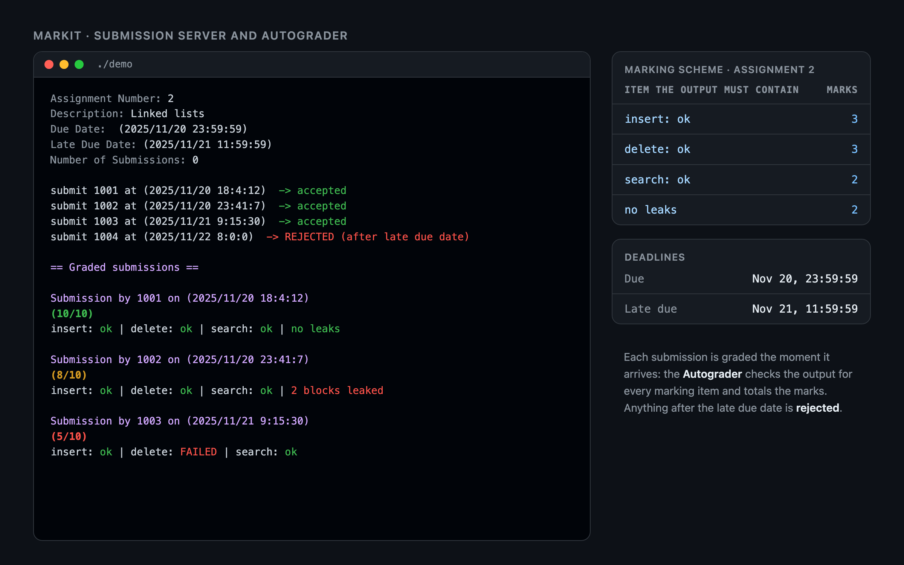
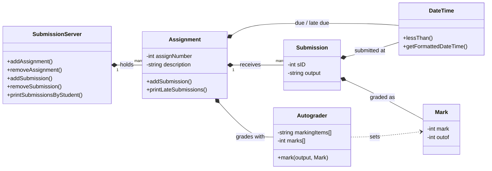

# Markit

An assignment submission server and autograder in C++. Instructors create assignments with a due
date, a late due date and a marking scheme. Students submit their program's output, and Markit
grades each submission automatically and keeps it with its timestamp and mark.



`./demo` ([demo.cc](demo.cc)) sets up one assignment with a marking scheme and submits four
outputs through `SubmissionServer`. Each is graded as it arrives, and the one after the late due date
is rejected.

## How it works

- **`SubmissionServer`** holds every assignment. You can add and remove assignments and submissions,
  and print all submissions for an assignment or for one student.
- **`Assignment`** stores its description, due date, late due date, an `Autograder`, and the
  submissions it has received.
- **`Autograder`** has a list of marking items, each worth some marks. It checks a submission's output
  for each item and adds up the marks, so a grade is "found what we expected, item by item".
- **`Submission`** records the student number, the output, when it was submitted (`DateTime`) and the
  resulting `Mark` (x out of y).

All storage uses fixed-size arrays (`MAX_ARRAY` in `defs.h`), with no STL containers.



## Build and run

```bash
make
./demo   # grade a few sample submissions
./a1     # run the test suites
```

`./a1` opens a menu of test suites that exercise every class. Option 6 runs everything:

```text
Testing Print Submission class

Submission by 1001 on (2024/1/1 1:1:1)
(10/10)
AAA
...
Points earned: 4/4
Points earned: 3/3
Points earned: 8/8
...
Your score is 30 out of 30
```

## Files

### Header files
- **`Assignment.h`** - Defines the Assignment class for managing multiple Submissions
- **`Submission.h`** - Defines the Submission class representing a student's submission with the time and mark
- **`DateTime.h`** - Defines a date/time class for everything else to use
- **`Mark.h`** - Defines the Mark class for grades (x out of y)
- **`Autograder.h`** - Defines the Autograder class for grading each student's output
- **`SubmissionServer.h`** - Defines the SubmissionServer class for managing multiple assignments
- **`Tester.h`** - Defines the Tester class for testing cases of the other classes
- **`defs.h`** - Contains global constant for MAX_ARRAY

### Implementation files
- **`Assignment.cc`** - Implements Assignment class methods
- **`Submission.cc`** - Implements Submission class methods
- **`DateTime.cc`** - Implements DateTime class methods
- **`Mark.cc`** - Implements Mark class methods
- **`Autograder.cc`** - Implements Autograder class methods
- **`SubmissionServer.cc`** - Implements SubmissionServer class methods
- **`Tester.cc`** - Implements Tester class methods
- **`main.cc`** - The main function being run by the executable

### Build files
- **`Makefile`** - Build configuration for compiling the project
